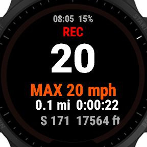
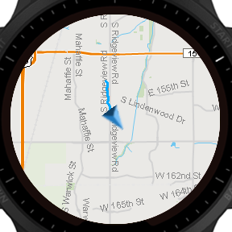
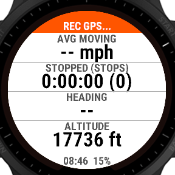
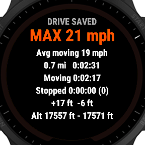
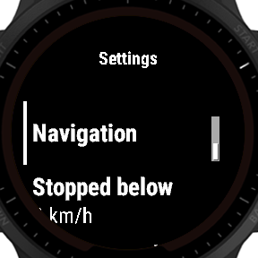
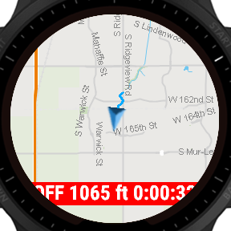

# garmin-car-drive

A Connect IQ **watch app** for the Forerunner 955 / Solar (`fr955`, API 5.2, SDK 9.2.0). It records car drives as a `SPORT_DRIVING` FIT activity, so running and cycling stats and PRs are left alone.

| Drive | Map | Stats |
|---|---|---|
|  |  |  |
| **Summary after save** | **Settings** | **Off course (nav on)** |
|  |  |  |

<sub>Simulator screenshots: random simulated data, and the simulator was set to statute units. The off-course shot is from a build whose overlay text was clipped; the text is smaller now.</sub>

## Use
| Button | Action |
|---|---|
| START | Start the drive. Pressing it again pauses and opens Resume / Save / Discard. Discard asks for confirmation. Save shows the summary. |
| UP / DOWN | Switch pages: Drive → Map → Stats |
| Hold UP | Idle: settings. Map page: pan/zoom mode (BACK leaves it) |
| BACK | Ignored while a drive is open. If the app is closed anyway, the open drive is saved. |

- **Drive page:** clock and battery, status (GPS… / GPS OK / REC / PAUSED / OFF COURSE), current speed, max speed, distance, timer, GPS heading, altitude.
- **Map page:** the watch's own map centred on you, your blue breadcrumb, and the purple route when navigation is on, with distance left or distance and time off course.
- **Stats page / summary:** max speed, average moving speed, distance, total time, moving and stopped time, number of stops (stopped ≥ 10 s), ascent and descent, min and max altitude.
- **Vibration** on start and pause. Leaving the route for more than 5 s triggers a tone and a long vibration.
- **Units** follow the watch's system settings.

## Settings (hold UP on the idle screen)
| Setting | Values | Default |
|---|---|---|
| Navigation | on / off | off |
| Stopped below | 1 / 2 / 3 / 5 / 8 km/h | 2 |
| Off-course alert | 50 / 100 / 200 / 500 m | 100 |

The same settings are also defined for the Garmin Connect phone app. That only works for apps installed from the Connect IQ Store, which is why the watch has its own settings menu.

## Navigation route
The route is bundled into the app (no network). To load a route:
```bash
tools/gpx2route.py my-route.gpx   # writes resources/route/route.json (max 500 points)
./build.sh                        # then sideload build/Car.prg
```
Export the GPX from Garmin Connect (Course → Export GPX) or any route planner. With no route bundled, navigation shows nothing.

## GPX export of a drive
This is already built in: on Garmin Connect web, open the activity → ⚙ → **Export to GPX** (or Export Original for the FIT file). The app doesn't do its own export, because a watch app can't write files you can see over USB, and the only other route off the watch is the phone or network.

## FIT data
Standard session fields include max speed, average speed, distance, ascent and descent. The app also writes three developer fields to the session: `moving_time`, `stopped_time` (seconds) and `stops`. Garmin Connect only shows developer fields for apps installed from the Store. For a sideloaded app they are in the FIT file but not shown in Connect.

## Build (WSL)
```bash
./build.sh       # -> build/Car.prg
./build.sh -t    # include the unit tests (source/Tests.mc)
```
`build.sh` points the Linux compiler at the Windows SDK and devices. The simulator runs on Windows:
`monkeydo.bat build\Car.prg fr955`. In the simulator, set Simulation → Activity Data → ▶ and Settings → Set GPS Quality → Good.

## Install on the watch
1. `./build.sh` (makes `build/Car.prg`).
2. Plug the watch in over USB. On Windows it shows up as a device (MTP) named "Forerunner 955".
3. Copy `Car.prg` into `Internal Storage\GARMIN\APPS\`.
4. Unplug. On the watch: START → scroll the activity/app list → **Car** (add it to favourites from there).

To update, copy over the same file. To remove it, delete it from `GARMIN\APPS`. Settings are kept until then.

## Phase 0 findings (SDK 9.2.0 docs and the fr955 device API)
| # | Question | Finding |
|---|---|---|
| 1 | Sport type | `Activity.SPORT_DRIVING`. The SDK says the sport "is not guaranteed to change device behavior". Whether it counts toward training load or Body Battery **needs a real upload to confirm**. PRs are sport-scoped. |
| FR-4 | Sampling rate | `createSession` has no rate option, so the device default is used. |
| 2 | GPS mode | `CONFIGURATION_GPS` (GPS only, lowest power) is used. SatIQ and multi-band are also available. UltraTrac is not exposed. |
| 3 | Max speed in Connect | Standard FIT session field, so no developer field is needed. |
| 5 | Maps | `MapTrackView` + `MapPolyline` work in a watch app (confirmed in the simulator). In the simulator only one polyline showed at a time, so with nav on the route line is shown in preference to the breadcrumb. Check this on the watch. |
| 6 | Native navigation | No. Courses only expose name, id and `toIntent()`, and the intent exits the app. Off-course detection and alerts are the app's own (distance to the route polyline). No turn-by-turn. |
| 7 | Route import | Bundled JSON resource, built from GPX with `tools/gpx2route.py`. |
| 8 | Map cost | Not measured yet. The breadcrumb gets one point per 6 s moving, capped at 2400 points (about 4 h). The FIT track is always complete. |

## Not possible / skipped
- **Heart rate on/off setting:** there's no API to stop the wrist sensor from recording in a session. Turn wrist HR off on the watch itself if you need to.
- **North-up vs heading-up:** controlled by the watch's map settings; there's no API for it.
- Phase 3 (accelerometer events, grade) has not been started.
